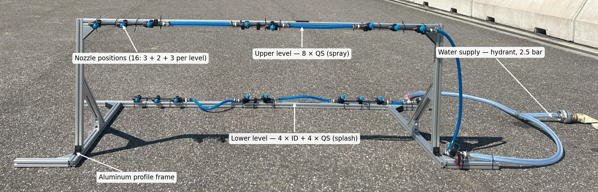
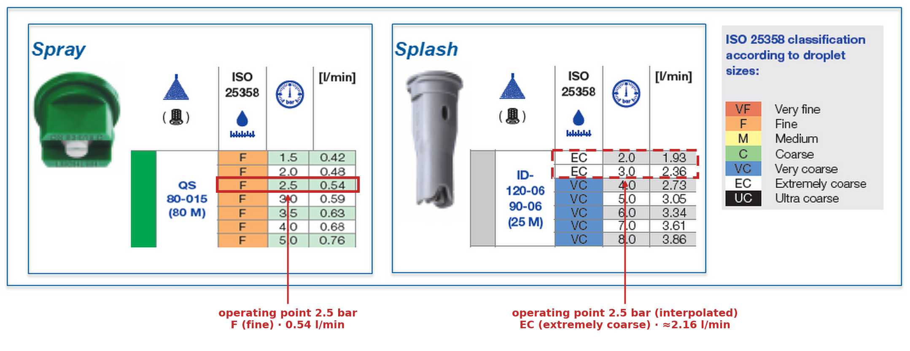
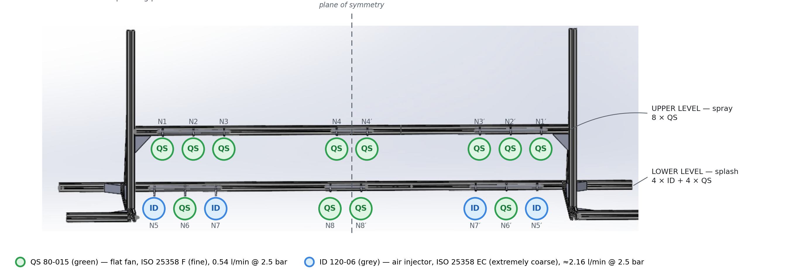

# Road Spray Testbed

[← Back to main page](README.md)

This page documents the road spray testbed used to record the SimRoadSpray dataset. It
describes the frame, the two nozzle types, their positions on the frame and the operating point. The configuration described here is the one used for all recordings
reported in the paper.

---

## 1. Design

Road spray results from two related but distinct processes:

- **Splash**: larger droplets (> 1.0 mm in diameter) that follow ballistic trajectories away from
  the tires. Splash concentrates near road level and around the tire regions.
- **Spray**: finer droplets (< 0.5 mm) that remain suspended in the turbulent airflow behind the
  vehicle and disperse towards the upper and central areas of the vehicle body.

The testbed reproduces both processes with two nozzle types. Coarse-droplet nozzles on the lateral
sections of the lower level emulate splash at the tire regions. Fine-droplet nozzles on the upper
level and in the central positions emulate the suspended spray. The arrangement was selected in
preliminary tests by comparing the spray plume, recorded with an HD camera, against proving-ground
reference recordings of two vehicles under synthetic rain.

## 2. Hardware



| Element | Description |
|---|---|
| Frame | Modular aluminum-profile frame with two vertical posts and floor-level feet |
| Upper level | 8 nozzle positions, grouped 3 + 2 + 3 (lateral group, central pair, lateral group) |
| Lower level | 8 nozzle positions, grouped 3 + 2 + 3, mounted closer to the floor |
| Nozzle positions | 16 in total; each position can be fitted with a different nozzle type |
| Water supply | Indoor hydrant via flexible hose, supply pressure **2.5 bar** |
| Structural check | Finite element analysis of the nozzle supports under nominal flow conditions |

The supply pressure of 2.5 bar is the maximum pressure available from the indoor hydrant of the test
facility.

## 3. Nozzle types



Two types of commercially available agricultural flat-fan nozzles by Lechler were used. Droplet-size
classes follow **ISO 25358** (VF very fine, F fine, M medium, C coarse, VC very coarse, EC extremely
coarse, UC ultra coarse).

| Property | **QS** (spray) | **ID** (splash) |
|---|---|---|
| Datasheet designation | QS 80-015 (80 M) | ID-120-06 / ID-90-06 (25 M) |
| Principle | Standard flat fan | Air-injector flat fan |
| Nozzle color (ISO size code) | Green (015) | Grey (06) |
| ISO 25358 class at 2.5 bar | **F** (fine) | **EC** (extremely coarse) |
| Flow rate at 2.5 bar | **0.54 L/min** (tabulated) | **≈ 2.16 L/min** (interpolated) |
| Role in the testbed | Fine spray cloud | Splash at the tire regions |

## 4. Nozzle configuration



The CAD numbering defines the positions **N1–N8** on one half of the frame (N1–N4 on the upper level,
N5–N8 on the lower level). The configuration is mirror-symmetric about the vertical mid-plane of the
frame, so the other half repeats the same assignment. Mirrored positions are marked with a prime
(N1′–N8′).

| Position | Level | Location | Nozzle | ISO 25358 | Flow at 2.5 bar [L/min] | Count (both halves) |
|---|---|---|---|---|---|---|
| N1 | Upper | lateral group, outer | QS | F | 0.54 | 2 |
| N2 | Upper | lateral group, middle | QS | F | 0.54 | 2 |
| N3 | Upper | lateral group, inner | QS | F | 0.54 | 2 |
| N4 | Upper | central pair | QS | F | 0.54 | 2 |
| N5 | Lower | lateral group, outer | ID | EC | ≈ 2.16 | 2 |
| N6 | Lower | lateral group, middle | QS | F | 0.54 | 2 |
| N7 | Lower | lateral group, inner | ID | EC | ≈ 2.16 | 2 |
| N8 | Lower | central pair | QS | F | 0.54 | 2 |

Resulting pattern along each level (CAD view, left to right):

```
Upper level:  QS  QS  QS   |   QS  QS   |   QS  QS  QS
Lower level:  ID  QS  ID   |   QS  QS   |   ID  QS  ID
```

In total, **16 nozzles** are active: **12 QS** and **4 ID**.

## 5. Limitations

- **Static setup.** The testbed reproduces the spatial distribution of spray but not its dynamics,
  such as wake turbulence and droplet transport at driving speed.
- **Single operating point.** All recordings were made at 2.5 bar. A higher pressure would increase
  the flow of both nozzle types and, above 3 bar, shift the ID nozzles from class EC to VC.
- **Nominal values.** Droplet classes and flow rates come from the manufacturer datasheets; they were
  not measured at the testbed. The repeatability of the generated spray has not yet been quantified
  by repeated trials.

A second-generation testbed with an automated flow controller and a pump is planned, enabling higher
and adjustable supply pressures and finer control of the droplet-size distribution.

## 6. Files

```
testbed.md                              # this page
figures/testbed/
├── fig0_overview.jpg                   # photograph of the testbed
├── fig1_testbed_photo.jpg              # annotated photograph of the testbed
├── fig2_nozzle_layout.png              # nozzle configuration on the CAD model
└── fig3_nozzle_datasheets.png          # datasheets with the 2.5 bar operating points
```
